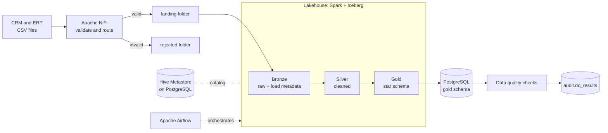
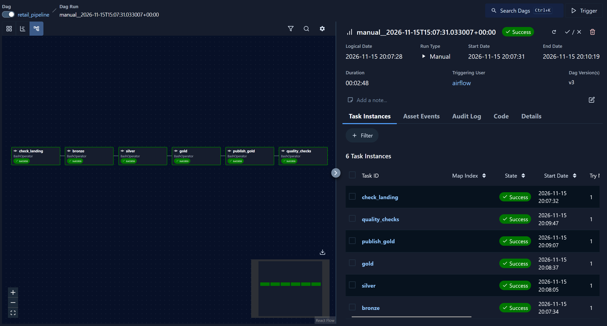
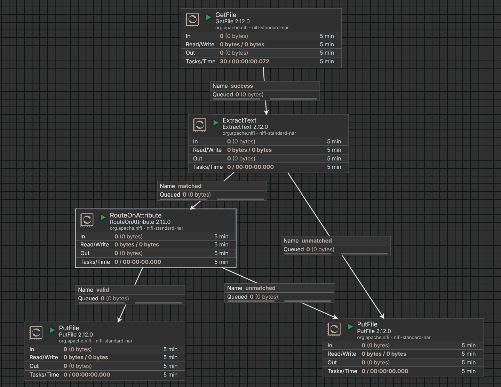

# Retail Lakehouse Pipeline

An end-to-end batch data pipeline that turns raw CRM and ERP CSV files into a
star-schema warehouse. Files are validated with **Apache NiFi**, transformed
through bronze, silver and gold layers stored as **Apache Iceberg** tables
(catalogued by a **Hive Metastore** on PostgreSQL) using **Spark**, published to
**PostgreSQL**, checked by automated data quality tests, and orchestrated by
**Apache Airflow**.

## What it does

- **Validates** every incoming CSV (file name, header, non-empty) before it enters the pipeline. Bad files go to a `rejected` folder.
- **Transforms** the data in three layers: bronze (raw plus load metadata), silver (cleaned and standardised), gold (star schema with surrogate keys).
- **Stores** every layer as Iceberg tables, so each load is a snapshot with history, time travel and rollback.
- **Publishes** the gold tables to PostgreSQL for reporting.
- **Checks quality** with 14 automated checks (emptiness, uniqueness, nulls, orphan rows, layer-to-layer reconciliation) and records every result in an `audit.dq_results` table.
- **Orchestrates** all of it as one daily Airflow DAG with retries, and fails loudly if a quality check fails.

## Architecture

## Tech stack

| Area | Tool |
| --- | --- |
| Ingestion and validation | Apache NiFi 2.12 |
| Processing | Apache Spark 3.5 (PySpark) |
| Table format | Apache Iceberg 1.12 |
| Catalog / metadata | Hive Metastore 4.0 backed by PostgreSQL 16 |
| Serving database | PostgreSQL 16 |
| Orchestration | Apache Airflow 3 (Docker, CeleryExecutor) |
| Packaging | Docker Compose |
| Language | Python 3.11 |

## The pipeline

1. **Ingestion (NiFi).** A NiFi flow picks up files from an inbox, reads the header line, and checks it against the expected header for that file name. Valid, non-empty files are written to `ingest/landing`; everything else goes to `rejected`. The exported flow is in `nifi/flows/`.
2. **Bronze, silver, gold (Spark + Iceberg).** Each layer is a set of Iceberg tables in the `lakehouse` catalog (`lakehouse.bronze.*`, `lakehouse.silver.*`, `lakehouse.gold.*`). Every layer is a full load using `createOrReplace`, so reruns never create duplicates.
3. **Publish (PostgreSQL).** `publish_gold.py` truncates and reloads the `gold` schema tables over JDBC, so the primary keys and foreign keys from the DDL stay intact.
4. **Data quality.** `run_quality_checks` runs 14 checks and appends each result to `audit.dq_results`. If any check fails the task exits non-zero and the DAG run fails.
5. **Orchestration (Airflow).** `check_landing >> bronze >> silver >> gold >> publish_gold >> quality_checks`, scheduled daily, with one retry per task.

## Iceberg features demonstrated

- **Snapshots and metadata tables:** `src/spark/iceberg_inspect.py` lists the snapshots and data files of `gold.fact_sales`.
- **Time travel:** `src/spark/iceberg_timetravel.py` reads `fact_sales` as of an older snapshot.
- **Rollback:** `src/spark/iceberg_rollback_demo.py` makes a bad insert and an accidental delete on a throwaway table, then undoes both by rolling back to an earlier snapshot.

## Data and credits

The source CSV files and the original warehouse design come from the
[Data With Baraa SQL Data Warehouse project](https://github.com/DataWithBaraa/sql-data-warehouse-project)
(MIT licence). The datasets are not stored in this repository. This project
re-implements that warehouse as a Python, Spark and Iceberg pipeline.
