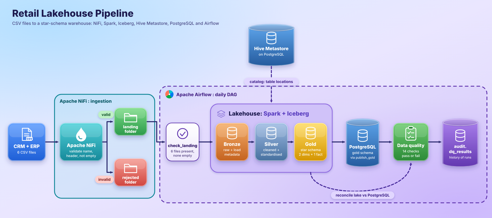

# Retail Lakehouse Pipeline

An end-to-end batch data pipeline that turns raw CRM and ERP CSV files into a
star-schema warehouse. Files are validated with **Apache NiFi**, transformed
through bronze, silver and gold layers stored as **Apache Iceberg** tables
(catalogued by a **Hive Metastore** on PostgreSQL) using **Spark**, published to
**PostgreSQL**, checked by automated data quality tests, and orchestrated by
**Apache Airflow**.

## What it does

- **Validates** every incoming CSV (file name, header, non-empty) before it enters the pipeline. Bad files go to a `rejected` folder.
- **Transforms** the data in three layers: bronze (raw plus load metadata), silver (cleaned and standardised), gold (star schema with surrogate keys).
- **Stores** every layer as Iceberg tables, so each load is a snapshot with history, time travel and rollback.
- **Publishes** the gold tables to PostgreSQL for reporting.
- **Checks quality** with 14 automated checks (emptiness, uniqueness, nulls, orphan rows, layer-to-layer reconciliation) and records every result in an `audit.dq_results` table.
- **Orchestrates** all of it as one daily Airflow DAG with retries, and fails loudly if a quality check fails.

## Architecture

  

Each coloured outline shows which technology runs which stage. Airflow's dashed
border wraps everything it controls, from `check_landing` to the quality checks. NiFi sits outside it, because NiFi runs
continuously on its own and Airflow only starts once validated files have landed.

## Tech stack

| Area | Tool |
| --- | --- |
| Ingestion and validation | Apache NiFi 2.12 |
| Processing | Apache Spark 3.5 (PySpark) |
| Table format | Apache Iceberg 1.12 |
| Catalog / metadata | Hive Metastore 4.0 backed by PostgreSQL 16 |
| Serving database | PostgreSQL 16 |
| Orchestration | Apache Airflow 3 (Docker, CeleryExecutor) |
| Packaging | Docker Compose |
| Language | Python 3.11 |

## How each stage works

### 1. Source data

- Six CSV files from two source systems: **CRM** (`cust_info`, `prd_info`, `sales_details`) and **ERP** (`CUST_AZ12`, `LOC_A101`, `PX_CAT_G1V2`).
- The files are dropped into an inbox folder. They are not stored in this repository.

### 2. Ingestion and validation (Apache NiFi)

- A NiFi flow picks up each file, reads its header line and compares it with the expected header for that file name.
- Valid, non-empty files are written to `ingest/landing`. Everything else goes to the `rejected` folder, so a malformed file can never reach the warehouse.
- Built from standard processors: `GetFile`, `ExtractText`, `RouteOnAttribute` and `PutFile`.
- The exported flow definition is in `nifi/flows/`.

### 3. Pre-flight check (Airflow task `check_landing`)

- First task of the DAG: confirms all six expected files exist in `ingest/landing` and none is empty.
- If a file is missing the task fails immediately with a clear message, instead of letting Spark fail later with a confusing error.

### 4. Bronze: raw layer (Spark + Iceberg)

- Reads each CSV with an **explicit schema** (no type guessing).
- Applies no cleaning, so bronze always mirrors the source.
- Adds two technical columns: `dwh_load_date` (when it was loaded) and `dwh_source_file` (which file it came from).
- Writes six Iceberg tables, `lakehouse.bronze.*`, with `createOrReplace`: a full load, so reruns never create duplicates.

### 5. Silver: cleaned layer (Spark + Iceberg)

- Customers: removes rows without an id, keeps only the newest record per customer, trims names and spells out marital status and gender codes.
- Products: splits the product key into category id and key, fills missing costs with 0, names the product lines, and derives each version's end date from the next start date.
- Sales: converts integer dates such as `20101229` to real dates and repairs wrong sales and price values.
- ERP data: removes the `NAS` prefix from customer ids, nulls out future birthdates, standardises gender and country names.
- Writes `lakehouse.silver.*` with `createOrReplace`.

### 6. Gold: star schema (Spark + Iceberg)

- Builds `dim_customers` (18,484 rows), `dim_products` (295 rows, current products only) and `fact_sales` (60,398 rows).
- Surrogate keys are generated with `row_number()`. The fact table is joined to the saved dimensions, so it holds exactly the keys that were written.
- CRM is the primary source for gender, with ERP as the fallback.
- Writes `lakehouse.gold.*` with `createOrReplace`.

### 7. Catalog and metadata (Hive Metastore + PostgreSQL)

- The Hive Metastore runs as a Docker container and stores one record per Iceberg table, pointing to that table's current metadata file.
- Its records live in a dedicated `metastore_db` database in PostgreSQL.
- Spark asks the catalog for `lakehouse.<layer>.<table>` by name, so no job ever hard-codes a file path.

### 8. Publish (PostgreSQL)

- `publish_gold` copies the three gold tables into the `gold` schema of PostgreSQL over JDBC, dimensions first, then the fact table.
- It uses `TRUNCATE` + insert instead of dropping the tables, so the primary keys, foreign keys and column types defined in `sql/postgres/` stay in place.
- Credentials come from the `.env` file, never from the code.

### 9. Data quality

- 14 automated checks: not empty, unique keys, no null keys, no orphan sales, `sales = quantity * price`, silver-to-gold row counts, and lake-to-PostgreSQL row counts and sales total.
- Each check returns a result instead of crashing, so every check runs even if an earlier one fails.
- Every result is appended to `audit.dq_results` with a run id and timestamp, which gives a full history of data quality over time.
- If any check fails, the task exits with an error and the Airflow run is marked failed.

### 10. Orchestration (Apache Airflow)

- One DAG, `retail_pipeline`: `check_landing >> bronze >> silver >> gold >> publish_gold >> quality_checks`.
- Scheduled daily, with one retry per task after a 2-minute delay.
- Runs in Docker on a custom image that adds Java and PySpark to the official Airflow image.
- Each task runs the matching Python module, so the same code can also be run by hand.

  

  

## Iceberg features demonstrated

- **Snapshots and metadata tables:** `src/spark/iceberg_inspect.py` lists the snapshots and data files of `gold.fact_sales`.
- **Time travel:** `src/spark/iceberg_timetravel.py` reads `fact_sales` as of an older snapshot.
- **Rollback:** `src/spark/iceberg_rollback_demo.py` makes a bad insert and an accidental delete on a throwaway table, then undoes both by rolling back to an earlier snapshot.

## Data and credits

The source CSV files and the original warehouse design come from the
[Data With Baraa SQL Data Warehouse project](https://github.com/DataWithBaraa/sql-data-warehouse-project)
(MIT licence). The datasets are not stored in this repository. This project
re-implements that warehouse as a Python, Spark and Iceberg pipeline.
